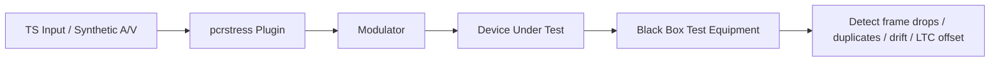

# PCRStress Plugin for TSDuck

## Overview

`pcrstress` is a TSDuck processor plugin designed to stress-test client-side PCR clock recovery. It allows controlled modification of PCR values in real-time to simulate drift, jitter, discontinuities, wrap-around, and other timing anomalies in MPEG transport streams.

The plugin operates either on a **PCR PID** (modifies only PCR values) or at the **service level** (modifies both PCR and DTS/PTS for a givenService ID), allowing consistent modification of all PIDs of a service. This enables tests that involve both PCR and PTS/DTS shifts without breaking playout.

---

## Table of Contents

- [Overview](#overview)
- [Key Features](#key-features)
- [Plugin Parameters](#plugin-parameters)
- [PCR PID Mode vs Service-Level (SID) Mode](#pcr-pid-mode-vs-service-level-sid-mode)
  - [PCR PID Mode](#pcr-pid-mode-pid-pcr_pid)
  - [Service-Level Mode](#service-level-mode-sid-service_id)
  - [Mode-Specific Guidance](#mode-specific-guidance)
  - [Key Principle: When to Modify PTS/DTS](#key-principle-when-to-modify-ptsdts)
  - [Example Scenarios](#example-scenarios)
- [Test Modes and Diagrams](#test-modes-and-diagrams)
  - [1. Drift](#1-drift)
  - [2. Jitter (Random/Noise-like)](#2-jitter-randomnoise-like)
  - [3. Discontinuity](#3-discontinuity-)
  - [4. Wrap-around](#4-wrap-around-)
  - [5. PCR Offset/Skew Mode](#5-pcr-offsetskew-mode-)
  - [6. Offset / Skew (Service-level Mode)](#6-offset--skew-service-level-mode-)
  - [7. PCR Drop Mode (Random PCR Removal)](#7-pcr-drop-mode-random-pcr-removal-)
  - [8. PCR Loss / Absence (Timed Removal)](#8-pcr-loss--absence-timed-removal-)
  - [9. PCR Spike Mode](#9-pcr-spike-mode-)
  - [10. Reference Service Concept](#10-reference-service-concept)
- [Synthetic A/V Test Setup with Black Box Verification](#synthetic-av-test-setup-with-black-box-verification)
  - [Implications for PCRStress Plugin](#implications-for-pcrstress-plugin)
  - [Test Setup Diagram](#test-setup-diagram)
- [Testing Drift Mode](#testing-drift-mode)
  - [Without Black Box Equipment (Software Analysis)](#without-black-box-equipment-software-analysis)
  - [With Black Box Test Equipment (End-to-End Validation)](#with-black-box-test-equipment-end-to-end-validation)
- [Usage Examples](#usage-examples)

---

## Key Features

- Modify PCR values in-flight for testing receiver STC recovery
- Operates at **two scopes**:
  - **PCR PID**: single PID, fine-grained modification (default)
  - **Service-level (SID)**: all PIDs of a service, allows consistent PCR + PTS/DTS modifications
- Support for **eight test modes**:
  - **Drift**: Gradual PCR rate changes (simulate clock drift)
  - **Jitter**: High-frequency random PCR variations (noise filtering)
  - **Discontinuity**: Abrupt PCR jump at specified time (ad insertion, channel switching)
  - **Wrap-around**: Simulate PCR counter wraparound at 32/33/42-bit boundaries (long broadcasts, buggy implementations)
  - **Offset/Skew**: Constant PCR offset throughout stream (A/V sync testing)
  - **Drop**: Random PCR packet removal (simulate packet loss)
  - **Loss**: Timed PCR absence for controlled duration (STC holdover testing)
  - **Spike**: PCR bursts for outlier detection testing (consecutive packet confirmation thresholds)
- Configurable PID or service, step parameters, and logging
- Verbose mode for detailed PCR modification tracking

---

## Plugin Parameters

| Parameter | Type | Description | Applicable Modes | Default |
|-----------|------|-------------|------------------|---------|
| `--pid`, `-p` | integer | PCR PID to modify (TS-level mode). Mutually exclusive with `--sid` | All | N/A |
| `--sid`, `-s` | integer | Service ID to modify (service-level mode). Mutually exclusive with `--pid` | drift, discontinuity, wrap, offset | N/A |
| `--mode`, `-m` | string | Test mode: `drift`, `jitter`, `discontinuity`, `wrap`, `offset`, `drop`, `loss`, `spike` | All | `drift` |
| `--drift-ppm` | float | Drift rate in parts per million (ppm). Positive = faster, negative = slower | **drift** | 50.0 |
| `--jitter-ms` | float | Jitter amplitude in milliseconds. Random offset in [-jitter-ms, +jitter-ms] | **jitter** | 5.0 |
| `--jump-ms` | integer | PCR/PTS/DTS jump in milliseconds. Positive = forward, negative = backward | **discontinuity** | 1000 |
| `--discontinuity-after` | float | Time (seconds) after first PCR to apply discontinuity | **discontinuity** | 5.0 |
| `--wrap-at` | float | Time (seconds) after first PCR to force wrap-around | **wrap** | 5.0 |
| `--wrap-bits` | integer | Wrap boundary in bits: 32 (buggy implementations), 33 (PTS/DTS), or 42 (PCR) | **wrap** | 42 |
| `--offset-ms` | integer | Constant offset in milliseconds. Positive = ahead, negative = behind | **offset** | 0 |
| `--drop-percent` | float | Percentage of PCR packets to drop (0-100) | **drop** | 5.0 |
| `--loss-start-sec` | float | Start time (seconds from first PCR) for PCR removal | **loss** | 0.0 |
| `--loss-duration-sec` | float | Duration (seconds) of PCR removal. 0 = permanent loss until end of stream | **loss** | 0.0 |
| `--spike-magnitude-ms` | integer | Spike offset magnitude in milliseconds | **spike** | 500 |
| `--spike-duration` | integer | Number of consecutive packets in each spike burst (1 = outlier, 3+ = accepted) | **spike** | 1 |
| `--spike-interval-sec` | float | Time (seconds) between spike bursts | **spike** | 5.0 |
| `--verbose`, `-v` | flag | Enable verbose logging of PCR/PTS/DTS modifications | All | false |

> **Note:** `--pid` and `--sid` are **mutually exclusive**.
> - `--pid` operates on a single PCR PID (classic TS-level mode)
> - `--sid` modifies all PIDs of the service (PCR + PTS/DTS, when applicable)

---

## PCR PID Mode vs Service-Level (SID) Mode

The plugin supports two operational scopes, each appropriate for different testing scenarios:

### PCR PID Mode (`--pid <PCR_PID>`)

**Operation:** Modifies only PCR values in the specified PID. PTS/DTS timestamps in video and audio streams remain unchanged.

**Use Cases:**
- Testing **STC clock recovery** in isolation
- Simulating **PCR-specific issues** (transmission errors, timestamping glitches)
- Validating **A/V synchronization tolerance** (PCR vs PTS/DTS skew)
- Testing **outlier detection** and filtering algorithms

**Recommended Modes:**
- ✅ **Offset** - Creates deliberate PCR/PTS skew to test A/V sync tolerance
- ✅ **Jitter** - Tests STC filtering of high-frequency PCR noise
- ✅ **Drop** - Tests STC tracking with missing PCR packets
- ✅ **Loss** - Tests STC holdover during PCR absence
- ✅ **Spike** - Tests outlier detection and consecutive packet confirmation
- ⚠️ **Wrap** - Tests PCR wraparound boundary handling (creates PCR/PTS skew at wrap point)

### Service-Level Mode (`--sid <SERVICE_ID>`)

**Operation:** Modifies PCR, PTS, and DTS consistently across all PIDs in the service (video, audio, subtitles). Maintains relative timing between all streams.

**Use Cases:**
- Testing **service-level timing changes** (entire program time shift)
- Simulating **broadcast timing adjustments** (network delays, satellite hop changes)
- Validating **decoder behavior under consistent timing modifications**
- Testing scenarios where all timestamps shift together (realistic for system-level issues)

**Recommended Modes:**
- ✅ **Drift** - Simulates gradual service-level time drift (satellite orbit drift, network jitter accumulation)
- ✅ **Discontinuity** - Tests decoder handling of service-wide timing jumps (ad insertion, channel switching)
- ✅ **Wrap** - Tests wraparound with maintained A/V sync (long-duration broadcast simulation)
- ⚠️ **Offset** - Can test service-level time offset, but less useful than PCR-only for A/V sync testing

**Not Recommended for SID Mode:**
- ❌ **Jitter** - PCR jitter without PTS/DTS jitter is the realistic scenario (PCR extraction noise)
- ❌ **Drop/Loss** - Missing PCR packets is PCR-specific; PTS/DTS remain in PES packets
- ❌ **Spike** - Outlier detection tests require PCR-only anomalies

### Mode-Specific Guidance

| Mode | PID Mode | SID Mode | Test Objective |
|------|----------|----------|----------------|
| **Offset** | ✅ **Recommended** | ⚠️ Possible | **PID:** Tests A/V sync tolerance (PCR ahead/behind PTS)<br>**SID:** Tests service-level time offset (less useful) |
| **Drift** | ✅ Useful | ✅ **Recommended** | **PID:** Tests STC tracking with PCR rate changes<br>**SID:** Tests service-level time drift (more realistic) |
| **Jitter** | ✅ **Recommended** | ❌ Not useful | **PID:** Tests PCR noise filtering (realistic: extraction/measurement jitter)<br>**SID:** Unrealistic (PTS/DTS don't have same jitter source) |
| **Discontinuity** | ✅ **Recommended** | ✅ Useful | **PID:** Tests PCR-only discontinuity (timestamping error)<br>**SID:** Tests service-wide timing jump (ad insertion, channel switch) |
| **Wrap** | ✅ Useful | ✅ **Recommended** | **PID:** Tests natural PCR wrap boundary (PTS/DTS continue, creates skew)<br>**SID:** Tests time-advanced wrap with A/V sync maintained (realistic long-duration) |
| **Drop** | ✅ **Recommended** | ❌ Not applicable | **PID:** Tests missing PCR packets<br>**SID:** PTS/DTS remain in PES packets (not lost with PCR) |
| **Loss** | ✅ **Recommended** | ❌ Not applicable | **PID:** Tests timed PCR absence (STC holdover)<br>**SID:** Same as Drop mode |
| **Spike** | ✅ **Recommended** | ❌ Not useful | **PID:** Tests PCR outlier detection<br>**SID:** Unrealistic (PTS/DTS don't have same outliers) |

### Key Principle: When to Modify PTS/DTS

**Modify PTS/DTS (use SID mode) when:**
- ✅ The timing change is **gradual and continuous** (drift)
- ✅ The timing change is **service-wide** (all streams affected together)
- ✅ Testing **realistic broadcast scenarios** (network delays, satellite timing adjustments)
- ✅ The timing change represents **system-level clock drift** (not PCR-specific issues)

**Do NOT modify PTS/DTS (use PID mode) when:**
- ❌ Testing **PCR-specific issues** (extraction errors, transmission glitches)
- ❌ Testing **A/V synchronization tolerance** (need PCR/PTS skew)
- ❌ Simulating **abrupt PCR changes** (discontinuity, wrap, spike)
- ❌ Testing **outlier detection** (anomalies should be PCR-only)
- ❌ Simulating **missing PCR packets** (PTS/DTS remain in PES packets)

---

## Test Modes and Diagrams

### 1. Drift

- **Purpose:** Simulate small, gradual PCR rate changes.
- **Effect:** Receiver STC should adjust playback rate smoothly.

```mermaid
gantt
    dateFormat  HH:mm:ss
    axisFormat  %S
    title PCR Drift Test
    section PCR (test)
    PCR drift     :a1, 00:00:00, 10s
    section PTS/DTS
    PTS           :b1, 00:00:00, 10s
    DTS           :c1, 00:00:00, 10s
```

- **Configuration:**  `--mode drift --drift-ppm <value>`


- PCR drifts gradually; PTS/DTS unchanged.

---

### 2. Jitter (Random/Noise-like)

- **Purpose:** Simulate rapid, random fluctuations in PCR.
- **Effect:** Tests PLL smoothing and jitter tolerance.

```mermaid
gantt
    dateFormat  HH:mm:ss
    title PCR Jitter Test (Random)
    section PCR
    PCR oscillates :a1, 00:00:00, 10s
    section PTS/DTS
    PTS           :b1, 00:00:00, 10s
    DTS           :c1, 00:00:00, 10s
```

- **Configuration:**  `--mode jitter --jitter-ms <value>`



**Implementation:** Random noise-like jitter
- Each PCR value receives a random offset uniformly distributed in `[-jitter_ms, +jitter_ms]`
- Simulates clock instability, temperature variations, and random transmission impairments
- Tests general jitter tolerance of receiver PLLs
- Independent random offset applied to each PCR (no correlation between successive values)

**Example:**
```bash
# Apply ±5ms random jitter to PID 101
tsp -I file input.ts \
    -P pcrstress --pid 101 --mode jitter --jitter-ms 5 \
    -O file output_jittered.ts
```

**Future Enhancement: Periodic Jitter**

For advanced PLL testing, periodic (sine wave) jitter could be added:

- **Configuration (proposed):** `--mode jitter --jitter-ms <amplitude> --jitter-freq-hz <frequency>`
- **Behavior:** PCR oscillates sinusoidally at specified frequency
- **Use case:** Test PLL's ability to filter out specific interference frequencies
- **Implementation:** `jitter_offset = amplitude × sin(2π × frequency × time)`

**Comparison:**

| Jitter Type | Current Implementation | Proposed Enhancement |
|-------------|----------------------|----------------------|
| **Random** | ✅ `--jitter-ms 5` | ✅ `--jitter-ms 5` (default when no frequency specified) |
| **Periodic** | ❌ Not available | 💡 `--jitter-ms 5 --jitter-freq-hz 100` |
| **Use Case** | General jitter tolerance | Specific frequency filtering |
| **Real-world analog** | Clock instability, noise | Muxer clock issues, interference |

**Recommendation:** The current random jitter implementation covers most use cases. Periodic jitter can be added later if needed for testing specific PLL filtering characteristics.

---

### 3. Discontinuity ✅

**Status:** Implemented

- **Purpose:** Test receiver behavior on abrupt PCR jumps (simulates stream splicing, channel changes, or ad insertion).
- **Effect:** Receiver PLL must re-acquire lock; may cause brief A/V freeze or skip.
- **Configuration:**  `--mode discontinuity --jump-ms <value> [--discontinuity-after <seconds>]`

**Parameters:**
- `--jump-ms`: Jump size in milliseconds (positive = forward jump, negative = backward jump). Default: 1000 ms
- `--discontinuity-after`: Time in seconds from first PCR when discontinuity is applied. Default: 5.0 seconds

**Implementation Details:**
- First PCR is used as time reference (t=0)
- Discontinuity is applied at the first PCR after the specified time
- After discontinuity, all subsequent PCRs maintain the offset (step function)
- PCR continuity is maintained (no rate changes, just instantaneous offset)

**Test Results:**
- ✅ Tested with +500ms jump at 5.0 seconds
- ✅ Jump applied with 100% accuracy (13,500,000 PCR units = 500.000 ms)
- ✅ Trigger timing within 34ms of target (5.034 sec vs 5.0 sec)
- ✅ Offset maintained perfectly across all subsequent PCRs
- ✅ PCR continuity verified: 972 PCR OK, 1 discontinuity detected

**Common Test Scenarios:**
- **Ad Insertion:** +200ms to +500ms jump
- **Channel Change:** +100ms to +2000ms jump
- **DVR Rewind:** -500ms to -5000ms jump (backward time)
- **Failover:** +100ms to +1000ms jump

```mermaid
gantt
    dateFormat  HH:mm:ss
    title PCR Discontinuity Test
    section PCR
    PCR normal      :a1, 00:00:00, 5s
    PCR jump        :a2, 00:00:05, 1s
    PCR after jump  :a3, 00:00:06, 4s
    section PTS/DTS (service-level)
    PTS/DTS shifted :b1, 00:00:05, 1s
```


- Abrupt jump in PCR at specified time; PTS/DTS also shifted in service-level mode (SID) to maintain A/V sync.

**See also:** [tests/discontinuity_test_results.md](tests/discontinuity_test_results.md) for comprehensive test documentation.

---

### 4. Wrap-around ✅

**Status:** Implemented

- **Purpose:** Test receiver handling of PCR counter wraparound at configurable bit boundaries. Simulates long-running broadcasts (42-bit PCR wraps after ~45 hours) or buggy implementations (32-bit truncation).
- **Effect:** PCR value drops from near-maximum to near-zero at configured boundary; receiver must handle modulo arithmetic correctly.
- **Configuration:** `--mode wrap [--wrap-at <seconds>] [--wrap-bits <bits>]`

**Parameters:**
- `--wrap-at`: Time in seconds from first PCR when wrap should occur. Default: 5.0 seconds
- `--wrap-bits`: Bit width of wrap boundary. Default: 42 (PCR standard)
  - **32**: Tests buggy implementations that truncate to 32-bit (2^32 = 4,294,967,296)
  - **33**: Tests PTS/DTS boundary (2^33 = 8,589,934,592)  
  - **42**: Tests proper PCR boundary (2^42 = 4,398,046,511,104)

**Implementation Details:**
- PCR wraps at configured bit boundary (default 2^42)
- First PCR is positioned to cause wrap after specified time
- Plugin repositions PCRs near the boundary to force wrap at specified time
- Applies constant offset to all PCRs while maintaining natural progression
- Wrap detected automatically when PCR value decreases
- Modulo arithmetic ensures mathematical continuity

**Test Results:**
- ✅ Tested with wrap at 5.0 seconds (actual: 2.48 sec due to repositioning)
- ✅ PCR wrapped from 2,576,979,856,432 to 477,789
- ✅ Perfect continuity: 973 PCR OK, 0 discontinuities
- ✅ Identical PCR increments before/after wrap (34.45 ms vs 34.43 ms)
- ✅ No timing artifacts or jitter introduced

**Common Test Scenarios:**
- **Long Broadcast:** 42-bit wrap after 45 hours (natural occurrence)
- **Buggy 32-bit Implementations:** 32-bit wrap to detect truncation bugs
- **PTS/DTS Boundary Testing:** 33-bit wrap to test PTS/DTS handling
- **Stress Test:** Multiple wraps in short duration
- **Edge Case:** Wrap at stream start or end
- **Combined:** Wrap + drift or wrap + jitter

**Example Usage:**

```bash
# Test proper 42-bit PCR wrap (standard)
tsp -I file input.ts -P pcrstress --pid 101 --mode wrap --wrap-at 10 --wrap-bits 42 -O file wrap_42bit.ts

# Test buggy 32-bit implementation (detect truncation)
tsp -I file input.ts -P pcrstress --pid 101 --mode wrap --wrap-at 10 --wrap-bits 32 -O file wrap_32bit.ts

# Test PTS/DTS 33-bit boundary
tsp -I file input.ts -P pcrstress --pid 101 --mode wrap --wrap-at 10 --wrap-bits 33 -O file wrap_33bit.ts
```


```mermaid
gantt
    dateFormat  HH:mm:ss
    title PCR Wrap-around (configurable boundary)
    section PCR
    PCR approaching wrap :a1, 00:00:00, 5s
    PCR wrap             :a2, 00:00:05, 1s
    PCR after wrap       :a3, 00:00:06, 4s
    section PTS/DTS
    PTS/DTS continue     :b1, 00:00:00, 10s
```

- PCR wraps from maximum to near-zero at configured bit boundary, time continues monotonically.

**See also:** [tests/wrap_test_results.md](tests/wrap_test_results.md) for comprehensive test documentation.

---

### 5. PCR Offset/Skew Mode ✅

#### Overview

Offset mode applies a **constant time shift** to all PCR values throughout the stream. Unlike discontinuity mode (which applies a one-time jump), offset mode maintains the natural PCR progression but shifted in time.

This mode is critical for testing:
- A/V synchronization tolerance (±40ms audio-ahead, ±60ms video-ahead per EBU R37-2007)
- Autonomous STC offset adjustment when samples arrive late

#### Parameters

- **`--mode offset`**: Enables offset mode
- **`--offset-ms <value>`**: Offset in milliseconds
  - **Positive values**: PCR advances ahead (simulates early timing)
  - **Negative values**: PCR lags behind (simulates late timing)
  - **Range**: Typically ±50 to ±500 ms

#### Behavior

The offset is applied to **every PCR** in the stream:

```
Modified PCR = (Original PCR + offset_pcr) mod PCR_SCALE

where: offset_pcr = offset_ms × 27,000 (converting ms to 27 MHz PCR units)
```

**Key characteristics:**
- PCR increments remain unchanged (natural progression preserved)
- Offset is perfectly constant across all PCRs
- No discontinuity indicator is set
- PTS/DTS values remain unchanged (creates PCR-PTS timing skew)

#### Use Cases

**1. Test A/V Sync Tolerance**

```bash
# Audio-ahead scenario: PCR +40ms ahead of PTS
tsp -I file input.ts -P pcrstress --pid 101 --mode offset --offset-ms 40 -O file audio_ahead_40ms.ts

# Video-ahead scenario: PCR -60ms behind PTS  
tsp -I file input.ts -P pcrstress --pid 101 --mode offset --offset-ms -60 -O file video_ahead_60ms.ts

# Extreme case: PCR +100ms (should exceed tolerance)
tsp -I file input.ts -P pcrstress --pid 101 --mode offset --offset-ms 100 -O file audio_ahead_100ms.ts
```

**2. Test Late Sample Handling**

```bash
# Simulate samples arriving 200ms late
tsp -I file input.ts -P pcrstress --pid 101 --mode offset --offset-ms -200 -O file late_samples.ts

# Verify decoder autonomously adds STC offset to compensate
```

**3. Systematic A/V Sync Testing**

Test decoder behavior across range of offsets:

```bash
# Create test suite
for offset in -100 -60 -40 -20 0 20 40 60 100; do
    tsp -I file input.ts \
        -P pcrstress --pid 101 --mode offset --offset-ms $offset \
        -O file offset_${offset}ms.ts
done
```

#### Expected Decoder Behavior

**Positive Offset (PCR ahead of PTS/DTS):**
- STC advances faster than expected based on PTS
- Video/audio samples appear "early" relative to PCR
- Decoder may need to delay rendering
- **Audio-ahead condition**: Audio renders before video for same PTS

**Negative Offset (PCR behind PTS/DTS):**
- STC advances slower than expected
- Video/audio samples appear "late" relative to PCR
- Decoder may need to drop/skip samples that missed deadline
- **Video-ahead condition**: Video renders before audio for same PTS

**Tolerance Thresholds (EBU R37-2007):**
- Acceptable: Audio-ahead ≤ 40ms, Video-ahead ≤ 60ms
- Perceptible: Beyond these thresholds, users notice lip sync issues

#### Validation Method

**Software Analysis:**

```bash
# Extract PCRs from original and offset streams
tsp -I file input.ts -P pcrextract --pid 101 -O drop > original_pcr.csv
tsp -I file offset_100ms.ts -P pcrextract --pid 101 -O drop > offset_pcr.csv

# Verify offset is constant
# Every PCR should differ by exactly: offset_ms × 27,000
```

**Black Box Testing:**

1. Feed offset stream to DUT (decoder under test)
2. Measure A/V sync using black box analyzer
3. Verify:
   - A/V sync offset matches applied PCR offset
   - No frame drops/duplicates occur
   - Playback remains smooth

**Test Results:**

See [tests/offset_test_results.md](tests/offset_test_results.md) for detailed validation data.

---

### 6. Offset / Skew (Service-level Mode) ✅

**Status:** Implemented

- **Purpose:** Test recovery when PCR is consistently ahead or behind PTS/DTS at service level.
- **Effect:** Small A/V drift; receiver must compensate. Requires consistent PCR + PTS/DTS modification.

```mermaid
gantt
    dateFormat  HH:mm:ss
    title PCR Offset / Skew (Service-level)
    section PCR
    PCR offset  :a1, 00:00:00, 10s
    section PTS/DTS (service-level)
    PTS/DTS shifted :b1, 00:00:00, 10s
```

- **Configuration:**  `--sid <value> --mode offset --offset-ms <value>`


- Constant PCR offset; PTS/DTS also shifted for service-level consistency.

**Note:** Offset mode is more commonly used in PID mode to deliberately create PCR/PTS skew for A/V sync tolerance testing.

---

### 7. PCR Drop Mode (Random PCR Removal) ✅

#### Overview

Drop mode **randomly removes PCR values** from packets throughout the stream, simulating packet loss or PCR absence scenarios. Each PCR packet has an independent probability of having its PCR removed, creating a stochastic pattern of missing PCRs.

This mode is critical for testing:
- Render every sample exactly once (no duplicates/drops)
- Handle up to 5 consecutively missing PCR samples
- STC recovery and clock holdover during PCR gaps

#### Parameters

- **`--mode drop`**: Enables drop mode
- **`--drop-percent <value>`**: Percentage of PCR packets to drop
  - **Range**: 0-100%
  - **Default**: 5%
  - **Typical**: 5-25% for stress testing
  - **Extreme**: 50%+ for severe packet loss scenarios

#### Behavior

For each packet with PCR, the plugin:
1. Generates a random number in [0, 100]
2. If random < drop_percent, removes PCR from that packet
3. Packet structure preserved, only PCR removed from adaptation field

**Key characteristics:**
- Each PCR drop decision is independent (true random, not periodic)
- PCR values that survive remain unchanged
- Packet continuity counter unchanged
- Transport stream structure preserved
- PTS/DTS values unaffected

**Implementation Detail:**
- Uses `pkt.removePCR()` to clear PCR flag in adaptation field
- Uniform random distribution ensures statistical fairness
- Seeded with system time for reproducibility

#### Use Cases

**1. Test Missing PCR Handling**

```bash
# Light packet loss (5%)
tsp -I file input.ts -P pcrstress --pid 101 --mode drop --drop-percent 5 -O file drop_5pct.ts

# Moderate packet loss (15%)
tsp -I file input.ts -P pcrstress --pid 101 --mode drop --drop-percent 15 -O file drop_15pct.ts

# Severe packet loss (25%)
tsp -I file input.ts -P pcrstress --pid 101 --mode drop --drop-percent 25 -O file drop_25pct.ts
```

**2. Test STC Freewheel / Clock Holdover**

```bash
# Extreme loss (50%) - forces long PCR gaps
tsp -I file input.ts -P pcrstress --pid 101 --mode drop --drop-percent 50 -O file drop_50pct.ts
```

**3. Verify Frame Rendering**

```bash
# Drop PCRs and verify no duplicate/missing frames
tsp -I file input.ts -P pcrstress --pid 101 --mode drop --drop-percent 20 -O file drop_20pct.ts

# Feed to decoder, count frames with black box equipment
# Should render every frame exactly once despite missing PCRs
```

**4. Test Progressive Degradation**

Test decoder behavior across range of drop rates:

```bash
for rate in 5 10 15 20 25 30 40 50; do
    tsp -I file input.ts \
        -P pcrstress --pid 101 --mode drop --drop-percent $rate \
        -O file drop_${rate}pct.ts
done
```

#### Expected Decoder Behavior

**Low Drop Rate (5-10%):**
- STC should maintain lock
- Brief PCR gaps filled by oscillator
- Minimal visible impact on playback
- A/V sync maintained within tolerance

**Moderate Drop Rate (15-25%):**
- STC tracking becomes challenging
- Longer periods of clock freewheel
- Possible minor A/V sync drift
- Should recover when PCR resumes

**High Drop Rate (30-50%):**
- Severe STC tracking difficulty
- Extended freewheel periods
- Noticeable A/V sync drift
- May experience buffer under/overflow
- Possible frame drops or repeats

**Critical Threshold (>50%):**
- STC may lose lock entirely
- Decoder may fallback to audio-master or freewheel mode
- Significant playback degradation expected

#### Validation Method

**Software Analysis:**

```bash
# Extract PCRs to measure drop rate and gap distribution
tsp -I file input.ts -P pcrextract --pid 101 -O drop > original_pcr.csv
tsp -I file drop_10pct.ts -P pcrextract --pid 101 -O drop > drop_pcr.csv

# Count PCRs
wc -l original_pcr.csv drop_pcr.csv

# Analyze gap sizes (should show larger intervals where PCRs dropped)
```

**Statistical Validation:**

For N PCRs with drop rate P%:
- Expected drops: N × (P/100)
- Standard deviation: √(N × P/100 × (1 - P/100))

Example: 974 PCRs, 10% drop rate
- Expected: 97.4 ≈ 97 drops
- Std dev: ±9.3 drops
- Range: 88-107 drops (±1σ)

**Black Box Testing:**

1. Feed dropped stream to DUT
2. Monitor with analyzer:
   - Frame counter continuity
   - A/V sync offset over time
   - Buffer levels
   - Error indicators
3. Verify:
   - No duplicate frames
   - No missing frames
   - A/V sync recovers after gaps

**Test Results:**

See [tests/drop_test_results.md](tests/drop_test_results.md) for detailed validation data.

---

### 8. PCR Loss / Absence (Timed Removal) ✅

**Status:** Implemented

- **Purpose:** Test receiver behavior when PCR is completely absent for an extended period.
- **Effect:** Receiver STC freewheel mode; tests clock holdover and recovery after PCR resumes.
- **Configuration:**  `--mode loss --loss-start-sec <value> [--loss-duration-sec <value>]`

**Parameters:**
- `--loss-start-sec`: Time (in seconds from stream start) when PCRs should start being removed
- `--loss-duration-sec`: Duration (in seconds) for which PCRs are removed. If omitted or set to 0, PCRs are removed until end of stream (permanent loss).

**Behavior:**
- Plugin tracks elapsed time from first PCR in stream
- All PCRs within specified time window are removed
- PCRs before and after window remain unchanged
- Time calculation: elapsed_seconds = (current_PCR - first_PCR) / 27000000
- Removal starts when: elapsed >= loss_start_sec
- Removal ends when: elapsed >= loss_start_sec + loss_duration_sec (if duration > 0)

**Use Cases:**
1. **Temporary PCR loss:** Tests decoder's ability to maintain timing using freewheel STC, then re-lock when PCR returns
2. **Permanent PCR loss:** Tests decoder behavior when PCR never returns (full freewheel operation)
3. **Multiple loss periods:** Run plugin multiple times with different parameters to create periodic PCR outages
4. **STC holdover testing:** Verify decoder can maintain A/V sync during PCR absence using internal oscillator

```mermaid
gantt
    dateFormat  HH:mm:ss
    title PCR Loss/Absence Test
    section PCR
    PCR normal         :a1, 00:00:00, 5s
    PCR removed        :a2, 00:00:05, 10s
    PCR resumed        :a3, 00:00:15, 5s
    section PTS/DTS
    PTS/DTS continuous :b1, 00:00:00, 20s
    section Receiver STC
    STC locked         :c1, 00:00:00, 5s
    STC freewheel      :crit, c2, 00:00:05, 10s
    STC re-lock        :c3, 00:00:15, 5s
```



**Expected Decoder Behavior:**
- **Before loss (0-5s):** STC locked to PCR, normal operation
- **During loss (5-15s):** 
  - STC enters freewheel mode using local oscillator
  - Clock drift depends on oscillator accuracy (typically ±50-100 ppm)
  - Video/audio may experience gradual A/V sync drift
  - Buffer underflow/overflow possible if freewheel duration is long
- **After recovery (15-20s):**
  - STC must re-lock to resumed PCR values
  - May cause momentary frame drops/repeats during re-sync
  - A/V sync should stabilize within 1-2 seconds

**Stress Test Scenarios:**

| Scenario | `loss-start-sec` | `loss-duration-sec` | Expected Result |
|----------|------------------|---------------------|-----------------|
| Short outage | 10 | 2 | Brief freewheel, quick recovery |
| Medium outage | 10 | 10 | Noticeable A/V drift, recovery glitch |
| Long outage | 10 | 60 | Severe drift, possible buffer issues |
| Early loss | 1 | 5 | Tests initial STC lock robustness |
| Permanent loss | 5 | (omitted) | Full freewheel until end |

**Implementation Notes:**
- Plugin removes PCR from adaptation field but preserves packet structure
- Adaptation field flags are updated to indicate no PCR present
- PTS/DTS in PES packets remain unchanged (timing reference maintained)
- Packet continuity counter continues normally
- Time tracking begins from first PCR encountered in stream
- Verbose output shows loss period start/end markers

#### Usage Examples

**1. Test STC Holdover During 2-Second Loss**

```bash
# Remove PCRs for 2 seconds starting at 5-second mark
tsp -I file input.ts -P pcrstress --pid 101 --mode loss --loss-start-sec 5 --loss-duration-sec 2 -O file loss_2s.ts

# Verify with analysis
tsp -I file input.ts -P pcrextract --pid 101 -O drop > original_pcr.csv
tsp -I file loss_2s.ts -P pcrextract --pid 101 -O drop > loss_pcr.csv
```

**2. Test STC Re-lock After Extended Loss**

```bash
# Remove PCRs for 10 seconds starting at 5-second mark
tsp -I file input.ts -P pcrstress --pid 101 --mode loss --loss-start-sec 5 --loss-duration-sec 10 -O file loss_10s.ts
```

**3. Test Permanent PCR Loss**

```bash
# Remove all PCRs starting at 10-second mark until end
tsp -I file input.ts -P pcrstress --pid 101 --mode loss --loss-start-sec 10 -O file loss_permanent.ts

# Decoder must operate in full freewheel mode from 10s onward
```

**4. Test Early Loss / Initial Lock Robustness**

```bash
# Remove PCRs for 5 seconds starting at 1-second mark
tsp -I file input.ts -P pcrstress --pid 101 --mode loss --loss-start-sec 1 --loss-duration-sec 5 -O file loss_early.ts
```

**5. Progressive Stress Testing**

Test decoder holdover across range of loss durations:

```bash
for duration in 2 5 10 15 30 60; do
    tsp -I file input.ts \
        -P pcrstress --pid 101 --mode loss --loss-start-sec 5 --loss-duration-sec $duration \
        -O file loss_${duration}s.ts
done
```

#### Expected Decoder Behavior

**Short Loss (2-5 seconds):**
- STC should maintain lock using local oscillator
- Minimal visible impact on playback
- A/V sync maintained within tolerance (±80ms per EBU R37)
- Quick re-lock when PCR resumes

**Medium Loss (10-30 seconds):**
- STC freewheel becomes noticeable
- Clock drift accumulates (±50-100 ppm × duration)
- Example: 10s at 100 ppm = 1ms drift
- Possible minor A/V sync drift
- Re-lock may cause brief glitch (frame drop/repeat)

**Long Loss (>30 seconds):**
- Significant clock drift expected
- A/V sync may exceed acceptable thresholds
- Buffer under/overflow risk increases
- Re-lock may be challenging or fail
- Some decoders may switch to audio-master timing

**Permanent Loss:**
- Decoder operates in full freewheel mode
- Clock drift accumulates indefinitely
- A/V sync degrades progressively
- May fall back to audio PTS as timing master
- Ultimate behavior depends on decoder implementation

#### Validation Method

**Software Analysis:**

```bash
# Extract PCRs from original and loss streams
tsp -I file input.ts -P pcrextract --pid 101 -O drop > original_pcr.csv
tsp -I file loss_5s_2s.ts -P pcrextract --pid 101 -O drop > loss_pcr.csv

# Count PCRs to verify removal
wc -l original_pcr.csv loss_pcr.csv

# Analyze timing: PCRs should have gap at loss period
# Example: 2-second loss = ~55 missing PCRs (typical PCR interval 40ms)
```

**Gap Analysis:**

For 2-second loss with typical 40ms PCR interval:
- Expected PCRs removed: 2000ms / 40ms = 50 PCRs
- Actual may vary slightly due to stream structure
- Should see single large gap in PCR timeline

**Black Box Testing:**

1. Feed loss stream to DUT with reference video
2. Monitor during loss period:
   - Frame counter continuity
   - A/V sync offset (compare audio waveform to lip movement)
   - Buffer levels
   - STC status indicators
3. Verify at re-lock:
   - No duplicate/missing frames
   - A/V sync recovers to baseline
   - Smooth playback resumes

**Test Results:**

See [tests/loss_test_results.md](tests/loss_test_results.md) for detailed validation data.

---

### 9. PCR Spike Mode ✅

#### Overview

Spike mode injects controlled PCR bursts to test **outlier detection** and **consecutive packet confirmation thresholds** in decoders. It simulates scenarios where PCR values briefly deviate from their expected trajectory, requiring decoders to distinguish between:

- **Single-packet anomalies** (noise, transmission errors, measurement glitches) → Should be ignored
- **Multi-packet discontinuities** (real timing changes) → Should be accepted and tracked

This mode validates that decoders implement proper outlier rejection, preventing spurious timing jumps from single erroneous PCR values while still responding to legitimate discontinuities confirmed by multiple consecutive packets.

#### Parameters

- **`--mode spike`**: Enables spike mode
- **`--spike-magnitude-ms <value>`**: Magnitude of PCR offset during spike (milliseconds)
  - **Default**: 500 ms
  - **Range**: 1 to 10,000 ms
  - **Typical test values**: 100-1000 ms
- **`--spike-duration <packets>`**: Number of consecutive packets in each spike burst
  - **Default**: 1 packet
  - **Range**: 1 to 10 packets
  - **Industry standard**: 2-3 packets needed to accept discontinuity
- **`--spike-interval-sec <seconds>`**: Time between spike bursts (seconds)
  - **Default**: 5.0 seconds
  - **Range**: 0.1 to 3600.0 seconds
  - **Typical**: 2-10 seconds for stress testing

#### Behavior

Spike mode operates by:

1. **Tracking elapsed time** from the first PCR encountered
2. **Triggering bursts** at intervals specified by `--spike-interval-sec`
3. **Applying spike offset** to `N` consecutive PCR-carrying packets (where N = `--spike-duration`)
4. **Resetting burst state** after completing each burst
5. **Repeating** the cycle for the duration of the stream

**PCR Calculation:**
```
Modified PCR = (Original PCR + spike_offset) mod PCR_SCALE

where: spike_offset = spike_magnitude_ms × 27,000 (27 MHz PCR clock)
```

**Consecutive Packet Logic:**
- When a burst is triggered, the plugin marks the next N PCR packets for spiking
- Each of these N packets receives the same positive offset
- After N packets, the burst ends and the plugin waits for the next interval

#### Industry Context

**Why Consecutive Packet Confirmation?**

Broadcast equipment and transmission paths can introduce sporadic PCR errors:
- RF interference causing bit flips
- Multiplexer glitches during stream switching
- Measurement errors in PCR extraction hardware
- Single-packet loss/corruption in IP delivery

To avoid spurious timing adjustments from these anomalies, decoders implement **consecutive packet confirmation**: only accept a PCR discontinuity as "real" if it persists across 2-3 consecutive packets.

**Common Thresholds:**
- **1 packet**: Always reject (outlier)
- **2 packets**: Borderline (implementation-dependent)
- **3+ packets**: Widely accepted as confirmation threshold

#### Usage Examples

**1. Test Single-Packet Outlier Rejection**

```bash
# Inject 1-packet spikes every 5 seconds
tsp -I file input.ts \
    -P pcrstress --pid 101 --mode spike \
       --spike-magnitude-ms 500 \
       --spike-duration 1 \
       --spike-interval-sec 5.0 \
    -O file spike_1pkt.ts

# Expected: Decoder ignores spikes, smooth playback
```

**2. Test Two-Packet Borderline Case**

```bash
# Inject 2-packet spikes every 5 seconds
tsp -I file input.ts \
    -P pcrstress --pid 101 --mode spike \
       --spike-magnitude-ms 500 \
       --spike-duration 2 \
       --spike-interval-sec 5.0 \
    -O file spike_2pkt.ts

# Expected: Implementation-dependent (may accept or reject)
```

**3. Test Three-Packet Discontinuity Acceptance**

```bash
# Inject 3-packet spikes every 5 seconds
tsp -I file input.ts \
    -P pcrstress --pid 101 --mode spike \
       --spike-magnitude-ms 500 \
       --spike-duration 3 \
       --spike-interval-sec 5.0 \
    -O file spike_3pkt.ts

# Expected: Decoder accepts as real discontinuity, applies timing jump
```

**4. Determine Exact Confirmation Threshold**

Test decoder across range of burst durations:

```bash
for duration in 1 2 3 4 5; do
    tsp -I file input.ts \
        -P pcrstress --pid 101 --mode spike \
           --spike-magnitude-ms 500 \
           --spike-duration $duration \
        -O file spike_${duration}pkt.ts
done

# Analyze decoder behavior to find exact threshold
```

**5. Frequent Spike Stress Test**

```bash
# High-frequency spikes for robustness testing
tsp -I file input.ts \
    -P pcrstress --pid 101 --mode spike \
       --spike-magnitude-ms 1000 \
       --spike-duration 1 \
       --spike-interval-sec 2.0 \
    -O file spike_stress.ts

# Verify decoder maintains stability under frequent outliers
```

**6. Large Magnitude Outlier**

```bash
# Extreme outlier to test filter robustness
tsp -I file input.ts \
    -P pcrstress --pid 101 --mode spike \
       --spike-magnitude-ms 5000 \
       --spike-duration 1 \
    -O file spike_extreme.ts

# Should still be rejected as single-packet anomaly
```

#### Expected Decoder Behavior

**Single-Packet Spikes (duration = 1):**
- ✅ Decoder should **reject** spike as outlier
- ✅ PCR timeline remains smooth (ignoring anomaly)
- ✅ No audio/video discontinuity
- ✅ STC continues tracking normal PCR progression

**Two-Packet Spikes (duration = 2):**
- ⚠️ **Borderline case** (implementation-dependent)
- Some decoders accept (2-packet threshold)
- Others reject (requiring 3+ packets)
- If accepted: Audio/video experiences timing jump equal to spike magnitude

**Three+ Packet Spikes (duration ≥ 3):**
- ✅ Decoder should **accept** as real discontinuity
- ✅ PCR timeline jumps by spike magnitude
- ✅ Audio/video experiences discontinuity (forward jump)
- ✅ STC adjusts to new PCR timeline
- ✅ Playback continues from new time base

#### Validation Method

**PCR Analysis:**

```bash
# Extract PCRs from original and spiked streams
tsp -I file input.ts -P pcrextract --pid 101 -O drop 2>&1 | grep ",PCR," > original.txt
tsp -I file spike_test.ts -P pcrextract --pid 101 -O drop 2>&1 | grep ",PCR," > spiked.txt

# Analyze spike patterns
python3 pcrstress/tests/analyze_spikes.py original.txt spiked.txt
```

The analysis script compares PCR values to identify offsets matching the spike magnitude.

**Black Box Testing:**

1. **Generate test streams** with varying spike durations (1-5 packets)
2. **Feed to DUT** with reference video containing frame counters
3. **Monitor playback** during spike bursts:
   - 1-packet spikes: Should see no glitches
   - 3+ packet spikes: Should see timing jump (audio/video discontinuity)
4. **Measure threshold**: Minimum consecutive packets needed for acceptance
5. **Verify stability**: Decoder recovers quickly after spike burst ends

**Key Performance Indicators:**

- **Outlier rejection**: Single-packet spikes ignored without artifacts
- **Discontinuity acceptance**: 3+ packet spikes properly applied
- **Threshold consistency**: Predictable behavior at 2-packet borderline
- **Recovery time**: Quick stabilization after burst ends
- **Robustness**: No crashes or degradation under frequent spikes

#### Plugin Statistics

Spike mode reports:
- Total number of spike bursts applied
- Total number of spike packets across all bursts

Example output:
```
pcrstress: 1 spike bursts applied (3 total spike packets)
```

This confirms:
- 1 burst was triggered
- 3 packets were spiked (matching `--spike-duration 3`)

#### Comparison with Other Modes

| Mode | Type | Packets Affected | Purpose |
|------|------|-----------------|---------|
| **Spike** | Burst | N consecutive | Test outlier detection threshold |
| **Discontinuity** | One-time | All after jump | Test discontinuity handling |
| **Jitter** | Continuous | All | Test noise filtering |
| **Drop** | Random | Random removal | Test missing PCR tolerance |
| **Loss** | Timed window | Window removal | Test STC holdover duration |

Spike mode is unique in testing **burst pattern recognition** rather than continuous anomalies or missing data.

**Test Results:**

See [tests/spike_test_results.md](tests/spike_test_results.md) for comprehensive validation data.

---

### 10. Reference Service Concept

- **Recommendation:** Use a separate **reference service** with unmodified PCR/PTS/DTS for baseline comparison.

```mermaid
gantt
    dateFormat  HH:mm:ss
    title Dual-Service Setup
    section Service A (Reference)
    PCR normal   :a1, 00:00:00, 10s
    PTS/DTS      :b1, 00:00:00, 10s
    section Service B (Test)
    PCR modified :c1, 00:00:00, 10s
    PTS/DTS modified :d1, 00:00:00, 10s
```



- **Service A:** Reference, unmodified, provides a stable STC baseline
- **Service B:** Test service, PCR/PTS/DTS modified as needed
- **Benefits of reference service:**
  - Baseline for comparison
  - Preserves playout for monitoring
  - Allows isolated testing without side-effects on other streams

---

## Synthetic A/V Test Setup with Black Box Verification

- Generate synthetic audio and video:
  - Video: 4-bit frame counter, QR code encoding frame timestamp
  - Audio: LTC timecode corresponding to audio frames
- Use **black box test equipment** to detect:
  - Frame counter changes → dropped/duplicated frames
  - QR code timestamps → video timing drift
  - LTC → audio clock drift
- Allows **end-to-end measurement** of PCR stress impact on decoded output

### Implications for PCRStress Plugin

- **Service-level mode** recommended when PTS/DTS is modified to ensure AV consistency.
- Black box output becomes **ground truth** for PCR recovery validation.
- Metrics to capture:
  1. Frame continuity → dropped/duplicated frames
  2. Video QR timestamp drift → PTS alignment
  3. Audio LTC drift → audio clock stability
  4. STC recovery error → inferred from timestamp differences

### Test Setup Diagram



- InputTS: synthetic A/V with frame counter, QR timestamps, LTC
- PCRPlugin: applies PCR stress
- DUT: decodes TS and outputs A/V
- BlackBox: measures output, reports drift, dropped/duplicated frames

---

## Testing Drift Mode

### Without Black Box Equipment (Software Analysis)

This approach uses TSDuck's built-in analysis tools to verify PCR drift modifications.

#### Test Setup

```bash
# Generate a test stream with PCR (or use existing TS file)
INPUT_FILE="test_stream.ts"  # Your input file with PCR

# Apply drift and save to output
tsp -I file "$INPUT_FILE" \
    -P pcrstress --pid <PCR_PID> --drift-ppm 100 --verbose \
    -O file output_drifted.ts

# Example with specific PID 256, +100 ppm drift
tsp -I file "$INPUT_FILE" \
    -P pcrstress --pid 256 --drift-ppm 100 --verbose \
    -O file output_100ppm.ts
```

#### Verification Methods

**Method 1: Use `tsanalyze` to compare PCR intervals**

```bash
# Analyze original stream
tsanalyze "$INPUT_FILE" > original_analysis.txt

# Analyze drifted stream  
tsanalyze output_100ppm.ts > drifted_analysis.txt

# Compare PCR bitrates - should show ~100 ppm difference
grep "PCR" original_analysis.txt | grep -i bitrate
grep "PCR" drifted_analysis.txt | grep -i bitrate
```

**Method 2: Use `pcrextract` plugin for detailed PCR analysis**

```bash
# Extract PCR values from original
tsp -I file "$INPUT_FILE" \
    -P pcrextract --pid <PCR_PID> -o original_pcr.csv \
    -O drop

# Extract PCR values from drifted stream
tsp -I file output_100ppm.ts \
    -P pcrextract --pid <PCR_PID> -o drifted_pcr.csv \
    -O drop

# Analyze the CSV files - PCR increment rate should differ by drift_ppm
# You can plot these in Excel, Python, or other tools
```

**Method 3: Use `pcrverify` to check PCR continuity**

```bash
# Verify PCR continuity in drifted stream
tsp -I file output_100ppm.ts \
    -P pcrverify --pid <PCR_PID> \
    -O drop

# Check for any discontinuities or timing issues
```

**Method 4: Calculate drift manually from verbose output**

When running with `--verbose`, pcrstress logs each PCR modification:
```
* pcrstress: PID 256: PCR 1234567890 -> 1234567900 (delta: +10, increment: 1000 -> 1000)
```

You can capture this output and verify the drift calculation:
- Expected drift factor = 1 + (drift_ppm / 1000000)
- For 100 ppm: factor = 1.0001
- Modified increment should be: original_increment × 1.0001

#### Expected Results

For **+100 ppm drift** (PCR advancing faster):
- PCR increments are 0.01% larger than original
- Effective bitrate appears 0.01% higher
- Over 1 hour of content, PCR advances by ~360 ms more than wall clock time

For **-100 ppm drift** (PCR advancing slower):
- PCR increments are 0.01% smaller than original
- Effective bitrate appears 0.01% lower
- Over 1 hour of content, PCR lags by ~360 ms behind wall clock time

---

### With Black Box Test Equipment (End-to-End Validation)

This approach measures the actual decoder output to validate STC recovery behavior.

#### Test Setup Architecture

```
┌─────────────┐    ┌──────────────┐    ┌───────────┐    ┌─────────┐    ┌──────────────┐
│   Source    │───>│  pcrstress   │───>│ Modulator │───>│   DUT   │───>│  Black Box   │
│  (TS File   │    │    Plugin    │    │    or     │    │ (STB/   │    │   Analyzer   │
│  or Stream) │    │              │    │  RF/IP    │    │  Tuner) │    │              │
└─────────────┘    └──────────────┘    └───────────┘    └─────────┘    └──────────────┘
                         ↓                                                      ↓
                    Apply drift                                        Measure output
                    PCR stress                                         timing/quality
```

#### Required Equipment

1. **Signal Source:** Transport stream file or live stream with embedded test patterns
2. **Modulator:** DVB-S/S2, DVB-T/T2, DVB-C, ATSC, ISDB-T, or IP streaming encoder
3. **DUT (Device Under Test):** Set-top box, TV, or decoder to test
4. **Black Box Analyzer:** Video/audio measurement equipment that can detect:
   - Frame counter discontinuities (dropped/duplicated frames)
   - QR code timestamps (video timing drift)
   - LTC timecode (audio clock drift)
   - A/V sync offset

#### Test Content Requirements

**Synthetic Test Stream with Embedded Metadata:**

1. **Video Stream:**
   - 4-bit frame counter overlay (increments each frame)
   - QR code with frame timestamp (PTS value or wall clock time)
   - Resolution: 1080p or 720p recommended
   - Frame rate: 25/30/50/60 fps

2. **Audio Stream:**
   - LTC (Linear Timecode) embedded in audio channels
   - Can be in separate audio track or encoded in stereo field
   - Should correlate with video frame timestamps

3. **Stream Properties:**
   - Constant bitrate (CBR) for consistent PCR intervals
   - Single program/service for simplicity
   - PCR interval: 40-100 ms (standard DVB practice)

#### Test Procedure

**Step 1: Baseline Reference Capture**

```bash
# Stream unmodified content to DUT
tsp -I file test_content.ts \
    -O ip 239.0.0.1:5000  # Or appropriate output for your modulator

# Black box captures output for 5-10 minutes
# Measure: frame rate, A/V sync, timing accuracy
```

**Step 2: Apply PCR Drift Stress**

```bash
# Apply +100 ppm drift
tsp -I file test_content.ts \
    -P pcrstress --pid <PCR_PID> --drift-ppm 100 --verbose \
    -O ip 239.0.0.1:5000

# Black box captures output for 5-10 minutes
# Expected behavior:
#   - Video should play slightly faster (0.01% speed increase)
#   - Frame counter should remain continuous (no drops/dups)
#   - QR timestamps should drift ahead of real time
#   - Audio LTC should match video drift
```

**Step 3: Apply Negative Drift**

```bash
# Apply -100 ppm drift (slower PCR)
tsp -I file test_content.ts \
    -P pcrstress --pid <PCR_PID> --drift-ppm -100 --verbose \
    -O ip 239.0.0.1:5000

# Black box captures output
# Expected behavior:
#   - Video should play slightly slower
#   - Frame counter continuous
#   - QR timestamps lag behind real time
#   - Audio LTC matches video drift
```

**Step 4: Stress Test - High Drift Values**

```bash
# Apply +500 ppm drift (more aggressive)
tsp -I file test_content.ts \
    -P pcrstress --pid <PCR_PID> --drift-ppm 500 --verbose \
    -O ip 239.0.0.1:5000

# This tests STC recovery limits
# May cause:
#   - Frame drops or duplicates
#   - A/V desync
#   - Buffer underflow/overflow
```

#### Measurement and Analysis

**Black Box Metrics to Capture:**

| Metric | Measurement | Expected with Drift | Failure Indication |
|--------|-------------|---------------------|-------------------|
| **Frame Counter Continuity** | Check for gaps/repeats | Continuous sequence | Dropped/duplicated frames |
| **QR Timestamp Drift** | Compare QR time vs. wall clock | Drift = drift_ppm × duration | Excessive drift or jumps |
| **Audio LTC Drift** | Compare LTC vs. wall clock | Same as video drift | A/V desync |
| **A/V Sync Offset** | Video vs. Audio timing | Should remain constant | Increasing offset = bad STC |
| **Playback Rate** | Frames per second | Original FPS × (1 + drift_ppm/1e6) | Judder, stutter, freezes |

**Calculation Examples:**

For **+100 ppm drift** over **10 minutes** (600 seconds):
- Expected drift: 600 s × 100 ppm = 60 ms
- QR timestamps should be 60 ms ahead of wall clock by end of test

For **+500 ppm drift** over **5 minutes** (300 seconds):
- Expected drift: 300 s × 500 ppm = 150 ms
- Video should play 150 ms worth of extra content

#### Pass/Fail Criteria

**Pass Criteria:**
- ✅ Frame counter remains continuous (no drops/duplicates)
- ✅ QR timestamp drift matches calculated drift (within ±10 ms tolerance)
- ✅ Audio LTC matches video timing (A/V sync ≤ 40 ms)
- ✅ Playback remains smooth (no visible judder)
- ✅ DUT does not freeze, crash, or lose sync

**Fail Criteria:**
- ❌ Frame drops or duplicates detected
- ❌ QR timestamp drift diverges from expected value
- ❌ A/V desynchronization exceeds 80 ms
- ❌ Visible playback artifacts (stutter, freeze, artifacts)
- ❌ DUT crashes or loses signal lock

#### Reporting Results

Generate a test report including:
1. DUT model and firmware version
2. Test content specifications (resolution, frame rate, bitrate)
3. Drift values tested (ppm)
4. Duration of each test
5. Black box measurements table
6. Screenshots of artifacts (if any)
7. Pass/fail verdict with justification

**Example Report Entry:**
```
Test: PCR Drift +100 ppm
DUT: Manufacturer Model XYZ, FW v2.1.3
Duration: 10 minutes
Results:
  - Frame continuity: PASS (no drops)
  - QR drift: 61 ms (expected: 60 ms) - PASS
  - A/V sync: 32 ms max deviation - PASS
  - Playback quality: Smooth, no artifacts - PASS
Verdict: PASS
```

---

## Usage Examples

```bash
# TS-level PCR drift on PID 100
tsp -I file input.ts -P pcrstress --pid 100 --mode drift --drift-ppm 50 -O file output.ts

# Apply random PCR jitter ±5 ms on PID 200
tsp -I file input.ts -P pcrstress --pid 200 --mode jitter --jitter-ms 5 -O file output.ts

# Apply higher jitter ±10 ms with verbose logging
tsp -I file input.ts -P pcrstress --pid 200 --mode jitter --jitter-ms 10 --verbose -O file output.ts

# Apply PCR discontinuity: +500ms jump after 5 seconds
tsp -I file input.ts -P pcrstress --pid 100 --mode discontinuity --jump-ms 500 --discontinuity-after 5 --verbose -O file output.ts

# Apply large discontinuity: +2 second jump after 10 seconds (simulates channel change)
tsp -I file input.ts -P pcrstress --pid 100 --mode discontinuity --jump-ms 2000 --discontinuity-after 10 -O file output.ts

# Apply backward discontinuity: -500ms jump (simulates DVR rewind)
tsp -I file input.ts -P pcrstress --pid 100 --mode discontinuity --jump-ms -500 --discontinuity-after 8 -O file output.ts

# Test PCR wrap-around after 5 seconds
tsp -I file input.ts -P pcrstress --pid 100 --mode wrap --wrap-at 5 --verbose -O file output.ts

# Force immediate wrap (at stream start)
tsp -I file input.ts -P pcrstress --pid 100 --mode wrap --wrap-at 0.1 -O file output.ts

# Test wrap with verbose logging for debugging
tsp -I file input.ts -P pcrstress --pid 100 --mode wrap --wrap-at 10 --verbose -O file output.ts

# Apply constant offset: +100ms to all PCRs
tsp -I file input.ts -P pcrstress --pid 100 --mode offset --offset-ms 100 -O file output.ts

# Apply negative offset: -50ms (simulate early PCR arrival)
tsp -I file input.ts -P pcrstress --pid 100 --mode offset --offset-ms -50 --verbose -O file output.ts

# Large constant offset: +500ms (test late sample handling)
tsp -I file input.ts -P pcrstress --pid 100 --mode offset --offset-ms 500 -O file output.ts

# Random PCR drop: remove 10% of PCRs (simulate light packet loss)
tsp -I file input.ts -P pcrstress --pid 100 --mode drop --drop-percent 10 -O file output.ts

# Aggressive PCR drop: remove 25% of PCRs (stress test)
tsp -I file input.ts -P pcrstress --pid 100 --mode drop --drop-percent 25 --verbose -O file output.ts

# Extreme PCR drop: remove 50% of PCRs (severe packet loss)
tsp -I file input.ts -P pcrstress --pid 100 --mode drop --drop-percent 50 -O file output.ts

# Service-level discontinuity on SID 5, shifting PCR + PTS/DTS (when implemented)
tsp -I file input.ts -P pcrstress --sid 5 --mode discontinuity --jump-ms 1000 -O file output.ts
```
